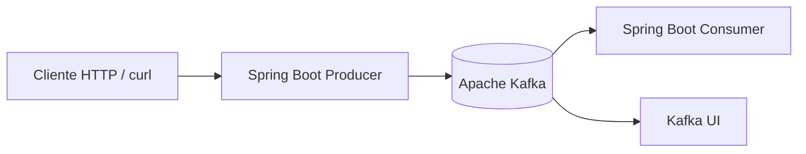
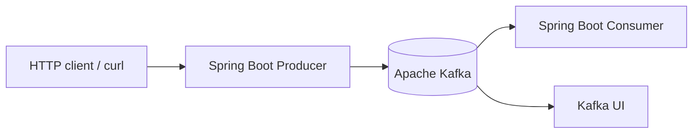

# Kafka Learning Lab

[Español](#español) | [English](#english)

## Español

Laboratorio práctico para estudiar Apache Kafka con aplicaciones separadas de productor y consumidor construidas con Spring Boot, además de un entorno Kafka + Kafka UI administrado mediante Docker Compose.

### Qué se practica

- Envío de mensajes desde una API productora.
- Consumo de mensajes desde una aplicación independiente.
- Uso de claves de mensaje para estudiar la distribución entre particiones.
- Topics, particiones, offsets y grupos de consumidores.
- Observación del clúster desde Kafka UI.
- Experimentos de consumo, reinicio y recuperación.

> Describe como implementado únicamente lo que puedas demostrar con el código actual. Este proyecto es un laboratorio de aprendizaje, no una plataforma de mensajería de producción.

### Arquitectura



### Tecnologías

- Java y Spring Boot (consulta cada `pom.xml` para confirmar versiones).
- Apache Kafka, configurado en `docker-compose.yml`.
- Kafka UI.
- Maven Wrapper, dentro de cada aplicación.

### Requisitos

- JDK compatible con los `pom.xml`.
- Docker Engine y Docker Compose.
- `curl` para probar la API, si los endpoints siguen configurados de esa forma.

### Levantar Kafka y Kafka UI

Desde la raíz del repositorio:

```bash
docker compose up -d
docker compose ps
docker compose logs -f kafka
```

Kafka está publicado en `localhost:9092` y Kafka UI en `http://localhost:8085`, de acuerdo con el `docker-compose.yml` actual.

Para detener el entorno:

```bash
docker compose down
```

Este comando conserva los datos si se agregan volúmenes persistentes. Si no hay volúmenes configurados, los datos pueden perderse al eliminar el contenedor.

### Ejecutar las aplicaciones

Abre dos terminales desde la raíz:

```bash
cd kafka-producer
./mvnw clean test
./mvnw spring-boot:run
```

En otra terminal:

```bash
cd kafka-consumer
./mvnw clean test
./mvnw spring-boot:run
```

Verifica los puertos y perfiles en `application.properties` o `application.yml` antes de documentar URLs definitivas.

### Probar la API

Ejemplo basado en el endpoint usado durante las pruebas del proyecto. Confirma que siga disponible antes de copiarlo:

```bash
curl -X POST "http://localhost:8091/api/messages?key=usuario-1" \
  -H "Content-Type: text/plain" \
  -d "Hola Kafka"
```

### Qué mostrar en una demo

1. Iniciar Kafka y Kafka UI.
2. Iniciar productor y consumidor.
3. Enviar un mensaje con una clave.
4. Mostrar el mensaje recibido y el topic correspondiente.
5. Reiniciar el consumidor y explicar el comportamiento observado.
6. Mostrar offsets y el grupo de consumidores con las herramientas de Kafka.

### Estructura

```text
.
├── docker-compose.yml
├── kafka-producer/
│   ├── pom.xml
│   └── src/
└── kafka-consumer/
    ├── pom.xml
    └── src/
```

### Siguientes mejoras

- [ ] Añadir pruebas unitarias y de integración para productor y consumidor.
- [x] Añadir CI para ambas aplicaciones Maven.
- [ ] Documentar el comportamiento de reintentos y errores.
- [ ] Añadir ejemplos reproducibles para claves, particiones y consumer groups.
- [ ] Fijar versiones de imágenes de contenedor en lugar de `latest`.
- [ ] Añadir una sección de limitaciones y seguridad.

## English

A hands-on lab for learning Apache Kafka with separate Spring Boot producer and consumer applications, plus a Kafka and Kafka UI environment managed by Docker Compose.

### Learning goals

- Send messages through a producer API.
- Consume messages in a separate application.
- Explore message keys, topics, partitions, offsets, and consumer groups.
- Observe Kafka through Kafka UI.
- Run controlled consumer restart and recovery experiments.

### Architecture



### Requirements

- A JDK matching the Maven projects.
- Docker Engine and Docker Compose.
- `curl` for API experiments.

### Start the infrastructure

From the repository root:

```bash
docker compose up -d
docker compose ps
docker compose logs -f kafka
```

Based on the current Compose file, Kafka is exposed at `localhost:9092` and Kafka UI at `http://localhost:8085`.

### Run the applications

Terminal 1:

```bash
cd kafka-producer
./mvnw clean test
./mvnw spring-boot:run
```

Terminal 2:

```bash
cd kafka-consumer
./mvnw clean test
./mvnw spring-boot:run
```

Verify the application configuration before relying on any port or endpoint.

### Roadmap

- [ ] Unit and integration tests for both applications.
- [x] CI for both Maven projects.
- [ ] Reproducible partition and consumer-group experiments.
- [ ] Document retries, error handling, and limitations.
- [ ] Pin container image versions.
